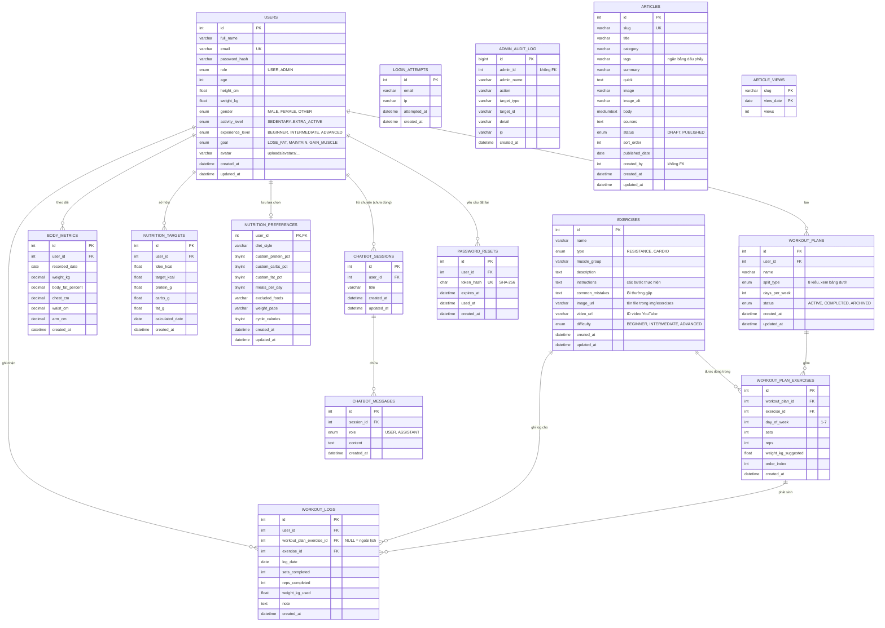

# ERD — GymSmart

Tài liệu thiết kế database, dùng làm tài liệu tham chiếu khi tạo/sửa bảng. Cập nhật file này mỗi khi thêm/sửa bảng (theo quy định trong `CLAUDE.md`).

Phạm vi: 2 role (`USER`, `ADMIN`), không có role Coach, không có chat giữa user với user. Nội dung học tập gồm ảnh + video hướng dẫn trong bảng `exercises` và **bài viết kiến thức** (bài dạng file trong `public/content/articles/` + bài admin soạn trong bảng `articles`).

Database dùng MySQL/MariaDB, quản trị qua phpMyAdmin. File tạo bảng thật là `/sql/schema.sql` (đã gộp mọi file bổ sung, chạy được trên database trống). Khi sửa cấu trúc bảng thì cập nhật cả file đó và file này.

> Mọi khóa chính/khóa ngoại là `INT` (riêng `admin_audit_log.id` là `BIGINT`). Bản cũ của tài liệu ghi `bigint` là không khớp với `schema.sql`.

---

## Sơ đồ quan hệ tổng quan

`LOGIN_ATTEMPTS`, `ADMIN_AUDIT_LOG`, `ARTICLES`, `ARTICLE_VIEWS` cố ý **không có khóa ngoại** (xem lý do ở từng bảng).

---

## Mô tả chi tiết từng bảng

### `users`
Lưu thông tin tài khoản và chỉ số cơ thể cơ bản (dùng chung để tính TDEE, không tách bảng riêng vì 1-1 với user).

| Cột | Kiểu | Ghi chú |
|---|---|---|
| id | int PK | |
| full_name | varchar | tối đa 100 ký tự (PHP kiểm tra ở đăng ký và hồ sơ) |
| email | varchar, unique | dùng để đăng nhập |
| password_hash | varchar | `password_hash()` của PHP (bcrypt, bắt đầu bằng `$2y$`) |
| role | enum | `USER`, `ADMIN`. Trang admin đọc lại cột này từ DB mỗi lần mở, không chỉ tin session |
| age, height_cm, weight_kg, gender | | dùng tính TDEE |
| activity_level | enum | hệ số hoạt động (ít vận động → vận động nhiều) |
| experience_level | enum | trình độ tập luyện (`BEGINNER`, `INTERMEDIATE`, `ADVANCED`), dùng cho gợi ý lịch tập và protein g/kg; cùng bộ giá trị với `exercises.difficulty` |
| goal | enum | mục tiêu (giảm mỡ / duy trì / tăng cơ), ảnh hưởng cách tính macro và gợi ý lịch tập |
| avatar | varchar, NULL | đường dẫn tương đối `uploads/avatars/<tên>.jpg`; NULL = hiện chữ cái đầu |

### `exercises`
Thư viện bài tập kèm ảnh và video hướng dẫn, do `ADMIN` quản lý (CRUD), user chỉ đọc. Dữ liệu: `sql/seed_exercises_v2.sql` (40 bài, id 1–40 cố định, `WORKOUT_EXERCISE_ROLES` trong `includes/workout-plan.php` dựa vào các id này) rồi `sql/seed_exercise_media.sql` (ảnh + video).

| Cột | Ghi chú |
|---|---|
| type | `RESISTANCE` (kháng lực) hoặc `CARDIO` |
| image_url | chỉ lưu **tên file** nằm trong `public/img/exercises/` (VD: `12.jpg`). PHP dựng đường dẫn bằng `exerciseImageSrc()` trong `includes/functions.php`; tên có `/`, `..` hoặc đuôi lạ bị bỏ qua. Ảnh từ nguồn mở (ghi nguồn nếu giấy phép yêu cầu) hoặc ảnh nhóm tự chụp |
| video_url | chỉ lưu **ID video YouTube** 11 ký tự (VD: `dQw4w9WgXcQ`), `youtubeEmbedUrl()` trong `includes/video.php` ghép thành link nhúng. Hàm này vẫn đọc được link YouTube đầy đủ nếu lỡ lưu |
| instructions | các bước thực hiện, **mỗi dòng một bước**, hiển thị thành danh sách đánh số |
| common_mistakes | lỗi thường gặp, **mỗi dòng một lỗi** |
| muscle_group | đúng 7 giá trị: `CHEST`, `BACK`, `SHOULDERS`, `LEGS`, `ARMS`, `ABS`, `FULL_BODY`. Trong DB là `VARCHAR(100)` (không phải ENUM) nên PHP phải kiểm tra danh sách cho phép trước khi dùng để lọc |
| difficulty | dùng trong thuật toán gợi ý lịch tập theo kinh nghiệm user |

### `workout_plans`
Mỗi user có thể có nhiều lịch tập theo thời gian, nhưng chỉ 1 lịch đang `ACTIVE` tại một thời điểm (ràng buộc xử lý ở PHP, `includes/workout-plan-db.php`).

`split_type` có 8 giá trị: `FULL_BODY`, `UPPER_LOWER`, `ANTERIOR_POSTERIOR`, `PPL`, `PPL_UL`, `UL_FULL_BODY`, `AP_FULL_BODY`, `BRO_SPLIT`. Database tạo trước khi có `sql/split_types.sql` chỉ có 4 giá trị đầu cũ, phải chạy file đó.

### `workout_plan_exercises`
Bảng trung gian nhiều-nhiều giữa `workout_plans` và `exercises`, có thêm thông tin riêng cho từng dòng (số set/rep, ngày trong tuần, thứ tự hiển thị).

### `workout_logs`
Ghi nhận thực tế mỗi lần user tập (khác với kế hoạch trong `workout_plan_exercises`).

> `workout_plan_exercise_id` nullable: tập ngoài lịch thì lưu NULL, chỉ bắt buộc `exercise_id`. Khi có giá trị, PHP kiểm tra dòng đó thuộc lịch ACTIVE của chính user (`saveWorkoutLog()`).

### `body_metrics`
Lưu theo mốc thời gian (không update đè), để vẽ biểu đồ tiến trình cân nặng/số đo. `weight_kg` bắt buộc, các số đo khác để trống = NULL. Có index `(user_id, recorded_date)`.

### `nutrition_targets`
Lưu kết quả tính TDEE/macro theo từng lần tính (không phải 1-1 cố định với user, vì chỉ số cơ thể/mục tiêu có thể thay đổi → giữ lịch sử).

### `nutrition_preferences`
Lựa chọn trên trang Dinh dưỡng, mỗi người tối đa 1 dòng (`user_id` là khóa chính): kiểu ăn, tỉ lệ % tùy chỉnh, số bữa, thực phẩm loại trừ (`excluded_foods`, các mã cách nhau bởi dấu phẩy), nhịp mục tiêu, bật/tắt calo theo ngày tập. Chưa import bảng thì trang giữ lựa chọn trong session.

### `chatbot_sessions`, `chatbot_messages`
**Chưa dùng.** Lịch sử hội thoại hiện lưu ở trình duyệt (`js/chatbot.js`) và gửi kèm mỗi lần hỏi. Giữ bảng cho bước "lưu lịch sử trên server" sau này.

### `password_resets`
Mã đặt lại mật khẩu. Chỉ lưu **bản băm SHA-256** của mã 32 byte ngẫu nhiên; mã thật chỉ có trong link. Hết hạn 30 phút (`expires_at`), dùng một lần (`used_at`). Xóa user thì xóa theo (CASCADE).

### `login_attempts`
Mỗi lần đăng nhập **sai** là một dòng. `includes/login-throttle.php` đếm trong 15 phút: 5 lần cùng email hoặc 20 lần cùng IP thì khóa. Đăng nhập đúng xóa các dòng của email đó; dòng cũ hơn 1 ngày tự xóa. Không có khóa ngoại vì email chưa đăng ký cũng phải được đếm.

### `admin_audit_log`
Nhật ký thao tác admin (đổi vai trò, xóa user, thêm/sửa/xóa/nhân bản bài tập, thêm/sửa/đăng/gỡ/xóa bài viết), ghi bởi `includes/audit-log.php`. Không có khóa ngoại: xóa tài khoản admin thì nhật ký vẫn còn (đã lưu cả tên).

### `articles`
Bài viết do admin soạn trên giao diện (`admin/articles.php`, `admin/article-form.php`). Bài dạng file trong `public/content/articles/` không nằm trong bảng này; `includes/articles.php` gộp hai nguồn. Nhãn lưu trong cột `tags` (ngăn bằng dấu phẩy), **không có** bảng `tags`/`article_tags`/`saved_articles`.

### `article_views`
Lượt xem bài gộp theo ngày (mỗi bài mỗi ngày một dòng). `slug` dùng chung cho bài file và bài DB nên không có khóa ngoại.

### `article_reads`
Người dùng đã đọc bài nền tảng nào (khóa chính `user_id` + `slug`), chỉ ghi các bài có nhãn "Đọc trước khi tập". Trang chủ dùng bảng này để nhắc bài chưa đọc. `user_id` có khóa ngoại tới `users` (xóa tài khoản thì xóa theo); `slug` không có khóa ngoại vì bài có thể nằm trong file.

---

## Ghi chú khi triển khai

- **Không có bảng Coach/CoachAssignment** và **không có bảng Message/Conversation giữa user-user**: đã loại khỏi phạm vi (xem `CLAUDE.md`)
- **Chatbot RAG đơn giản**: không cần bảng mới, chỉ query bảng `exercises` (tên, nhóm cơ, mô tả, `instructions`, `common_mistakes`) theo từ khóa rồi dẫn tới trang chi tiết bài tập
- Khi thêm bảng mới: tạo `sql/<tên>.sql` dùng `IF NOT EXISTS`, gộp vào `schema.sql`, **cập nhật sơ đồ mermaid và bảng mô tả phía trên**
- Tất cả bảng nên có `created_at`; bảng có thể chỉnh sửa (users, exercises, workout_plans, articles) có thêm `updated_at`
