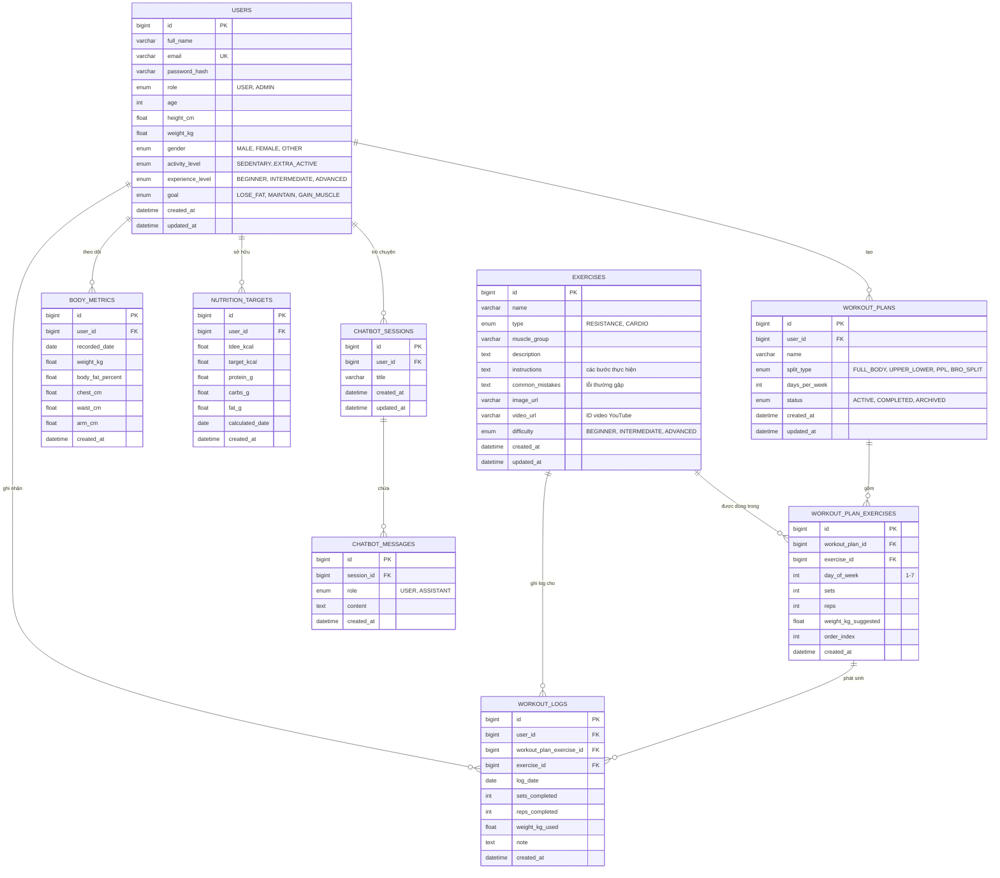

# ERD — GymSmart

Tài liệu thiết kế database, dùng làm tài liệu tham chiếu cho Claude Code khi tạo entity/migration. Cập nhật file này mỗi khi thêm/sửa entity mới (theo quy định trong `CLAUDE.md`).

Phạm vi: 2 role (`USER`, `ADMIN`), không có role Coach, không có chat giữa user với user, **không có module bài viết nghiên cứu** (đã thay bằng ảnh + video hướng dẫn nằm ngay trong bảng `exercises`).

Database dùng MySQL, quản trị qua phpMyAdmin. File tạo bảng thật nằm ở `/sql/schema.sql`; khi sửa cấu trúc bảng thì cập nhật cả file đó và file này.

---

## Sơ đồ quan hệ tổng quan

---

## Mô tả chi tiết từng bảng

### `users`
Lưu thông tin tài khoản và chỉ số cơ thể cơ bản (dùng chung để tính TDEE, không tách bảng riêng vì 1-1 với user).

| Cột | Kiểu | Ghi chú |
|---|---|---|
| id | bigint PK | |
| full_name | varchar | |
| email | varchar, unique | dùng để đăng nhập |
| password_hash | varchar | hash bằng BCrypt |
| role | enum | `USER`, `ADMIN` |
| age, height_cm, weight_kg, gender | | dùng tính TDEE |
| activity_level | enum | hệ số hoạt động (ít vận động → vận động nhiều) |
| experience_level | enum | trình độ tập luyện (`BEGINNER`, `INTERMEDIATE`, `ADVANCED`), dùng cho thuật toán gợi ý lịch tập; cùng bộ giá trị với `exercises.difficulty` |
| goal | enum | mục tiêu (giảm mỡ / duy trì / tăng cơ), ảnh hưởng cách tính macro và gợi ý lịch tập |

### `exercises`
Thư viện bài tập kèm ảnh và video hướng dẫn, do `ADMIN` quản lý (CRUD), user chỉ đọc. Đây cũng là nơi chứa toàn bộ nội dung "học tập" của website (thay cho module bài viết cũ).

| Cột | Ghi chú |
|---|---|
| type | `RESISTANCE` (kháng lực) hoặc `CARDIO` |
| image_url | ảnh minh họa dùng cho thẻ bài tập (ảnh từ nguồn mở như wger, hoặc ảnh nhóm tự chụp; ghi nguồn nếu giấy phép yêu cầu);chỉ lưu tên file nằm trong public/images/exercises/ |
| video_url | chỉ lưu **ID video YouTube** (VD: `dQw4w9WgXcQ`), PHP ghép thành link nhúng `https://www.youtube.com/embed/<ID>` khi hiển thị |
| instructions | các bước thực hiện, **mỗi dòng một bước** (ngăn cách bằng xuống dòng), hiển thị thành danh sách đánh số ở mục "Cách thực hiện" |
| common_mistakes | lỗi thường gặp, **mỗi dòng một lỗi**, hiển thị thành danh sách ở mục "Lỗi thường gặp" |
| muscle_group | đúng 7 giá trị: `CHEST`, `BACK`, `SHOULDERS`, `LEGS`, `ARMS`, `ABS`, `FULL_BODY`. Trong DB là `VARCHAR(100)` (không phải ENUM) nên PHP phải kiểm tra danh sách cho phép trước khi dùng để filter |
| difficulty | dùng trong thuật toán gợi ý lịch tập theo kinh nghiệm user |

### `workout_plans`
Mỗi user có thể có nhiều lịch tập theo thời gian, nhưng chỉ 1 lịch đang `ACTIVE` tại một thời điểm (ràng buộc xử lý ở tầng service, không cần constraint DB).

### `workout_plan_exercises`
Bảng trung gian nhiều-nhiều giữa `workout_plans` và `exercises`, có thêm thông tin riêng cho từng dòng (số set/rep, ngày trong tuần, thứ tự hiển thị).

### `workout_logs`
Ghi nhận thực tế mỗi lần user tập (khác với kế hoạch trong `workout_plan_exercises`) — dùng cho phần theo dõi tiến trình, biểu đồ khối lượng tập qua thời gian.

> Có thể tập không đúng theo plan (VD: tập thêm bài ngoài kế hoạch) → `workout_plan_exercise_id` để nullable, chỉ bắt buộc `exercise_id`.

### `body_metrics`
Lưu theo mốc thời gian (không update đè), để vẽ biểu đồ tiến trình cân nặng/số đo.

### `nutrition_targets`
Lưu kết quả tính TDEE/macro theo từng lần tính (không phải 1-1 cố định với user, vì chỉ số cơ thể/mục tiêu có thể thay đổi theo thời gian → giữ lịch sử để so sánh tiến trình).

### `chatbot_sessions`, `chatbot_messages`
Lưu lịch sử hội thoại với chatbot AI theo từng phiên, để giữ ngữ cảnh nhiều lượt trong 1 session (phục vụ Mức 2 trong `workflow.md` — cá nhân hóa theo dữ liệu user).

---

## Ghi chú khi triển khai

- **Không có bảng Coach/CoachAssignment** — đã loại khỏi phạm vi (xem `CLAUDE.md`)
- **Không có bảng Message/Conversation giữa user-user** — đã loại khỏi phạm vi
- **Không có bảng bài viết/tag** — module bài viết nghiên cứu đã bị loại, thay bằng video hướng dẫn trong `exercises`
- Với **Mức 3 chatbot AI (RAG đơn giản)**: không cần thêm bảng mới, chỉ cần query bảng `exercises` (mô tả, nhóm cơ, `instructions`, `common_mistakes`) theo từ khóa khi xử lý câu hỏi, rồi dẫn người dùng tới trang chi tiết bài tập; không bắt buộc vector DB
- Khi thêm entity mới ngoài danh sách này, **cập nhật lại sơ đồ mermaid và bảng mô tả phía trên**, không tạo entity "ngầm" không ghi vào tài liệu
- Tất cả bảng nên có `created_at`; bảng có thể chỉnh sửa (users, exercises, workout_plans) nên có thêm `updated_at`