# ERD — GymSmart

Tài liệu thiết kế database, dùng làm tài liệu tham chiếu khi tạo/sửa bảng. Cập nhật file này mỗi khi thêm/sửa bảng (theo quy định trong `CLAUDE.md`).

Phạm vi: 3 role (`USER`, `ADMIN`, `COACH`). `COACH` (huấn luyện viên, HLV) chỉ có được khi ADMIN duyệt đơn đăng ký HLV. Không có chat tự do giữa user với user: tin nhắn chỉ có giữa một HLV và học viên đang tập với HLV đó (bảng `coach_messages`). Nội dung học tập gồm ảnh + video hướng dẫn trong bảng `exercises` và **bài viết kiến thức** (bài dạng file trong `public/content/articles/` + bài admin soạn trong bảng `articles`).

Database dùng MySQL/MariaDB, quản trị qua phpMyAdmin. File tạo bảng thật là `/sql/schema.sql` (đã gộp mọi file bổ sung, chạy được trên database trống). Khi sửa cấu trúc bảng thì cập nhật cả file đó và file này.

> Mọi khóa chính/khóa ngoại là `INT` (riêng `admin_audit_log.id` là `BIGINT`). Bản cũ của tài liệu ghi `bigint` là không khớp với `schema.sql`.

---

## Sơ đồ quan hệ tổng quan

```mermaid
erDiagram
    USERS ||--o{ WORKOUT_PLANS : "tạo"
    USERS ||--o{ WORKOUT_LOGS : "ghi nhận"
    USERS ||--o{ BODY_METRICS : "theo dõi"
    USERS ||--o{ NUTRITION_TARGETS : "sở hữu"
    USERS ||--o| NUTRITION_PREFERENCES : "lưu lựa chọn"
    USERS ||--o{ CHATBOT_SESSIONS : "trò chuyện với GymSmart AI"
    USERS ||--o{ NOTIFICATIONS : "nhận thông báo"
    USERS ||--o{ WEEKLY_SUMMARIES : "tổng kết tuần (AI)"
    USERS ||--o{ COACH_PLAN_TEMPLATES : "HLV lưu mẫu lịch"
    COACH_PLAN_TEMPLATES ||--o{ COACH_PLAN_TEMPLATE_ITEMS : "gồm"
    COACH_CLIENTS ||--o| COACH_REVIEWS : "học viên đánh giá"
    EXERCISES ||--o{ COACH_PLAN_TEMPLATE_ITEMS : "dùng trong mẫu"
    USERS ||--o{ PASSWORD_RESETS : "yêu cầu đặt lại"

    EXERCISES ||--o{ WORKOUT_PLAN_EXERCISES : "được dùng trong"
    EXERCISES ||--o{ WORKOUT_LOGS : "ghi log cho"

    WORKOUT_PLANS ||--o{ WORKOUT_PLAN_EXERCISES : "gồm"
    WORKOUT_PLAN_EXERCISES ||--o{ WORKOUT_LOGS : "phát sinh"

    CHATBOT_SESSIONS ||--o{ CHATBOT_MESSAGES : "chứa"

    USERS ||--o{ COACH_APPLICATIONS : "nộp đơn HLV"
    USERS ||--o| COACH_PROFILES : "hồ sơ HLV"
    USERS ||--o{ COACH_CLIENTS : "là HLV (coach_id)"
    USERS ||--o{ COACH_CLIENTS : "là học viên (client_id)"
    COACH_CLIENTS ||--o{ COACH_FEEDBACK : "nhận xét"
    COACH_CLIENTS ||--o{ COACH_MESSAGES : "tin nhắn"
    COACH_CLIENTS ||--o{ COACH_CHANGE_REQUESTS : "xin tự sửa"
    WORKOUT_LOGS |o--o{ COACH_FEEDBACK : "nhận xét riêng 1 bài"
    USERS |o--o{ WORKOUT_PLANS : "giao lịch (assigned_by)"
    USERS |o--o{ NUTRITION_TARGETS : "đặt mục tiêu (assigned_by)"

    USERS {
        int id PK
        varchar full_name
        varchar email UK
        varchar password_hash
        enum role "USER, ADMIN, COACH"
        int age
        float height_cm
        float weight_kg
        enum gender "MALE, FEMALE, OTHER"
        enum activity_level "SEDENTARY..EXTRA_ACTIVE"
        enum experience_level "BEGINNER, INTERMEDIATE, ADVANCED"
        enum goal "LOSE_FAT, MAINTAIN, GAIN_MUSCLE"
        varchar avatar "uploads/avatars/..."
        datetime created_at
        datetime updated_at
    }

    EXERCISES {
        int id PK
        varchar name
        enum type "RESISTANCE, CARDIO"
        varchar muscle_group
        text description
        text instructions "các bước thực hiện"
        text common_mistakes "lỗi thường gặp"
        varchar image_url "tên file trong img/exercises"
        varchar video_url "ID video YouTube"
        enum difficulty "BEGINNER, INTERMEDIATE, ADVANCED"
        datetime created_at
        datetime updated_at
    }

    WORKOUT_PLANS {
        int id PK
        int user_id FK
        varchar name
        enum split_type "8 kiểu, xem bảng dưới"
        int days_per_week
        enum status "ACTIVE, COMPLETED, ARCHIVED"
        int assigned_by FK "HLV giao, NULL = tự tạo"
        datetime created_at
        datetime updated_at
    }

    WORKOUT_PLAN_EXERCISES {
        int id PK
        int workout_plan_id FK
        int exercise_id FK
        int day_of_week "1-7"
        int sets
        int reps
        float weight_kg_suggested
        int order_index
        datetime created_at
    }

    WORKOUT_LOGS {
        int id PK
        int user_id FK
        int workout_plan_exercise_id FK "NULL = ngoài lịch"
        int exercise_id FK
        date log_date
        int sets_completed
        int reps_completed
        float weight_kg_used
        text note
        datetime created_at
    }

    BODY_METRICS {
        int id PK
        int user_id FK
        date recorded_date
        decimal weight_kg
        decimal body_fat_percent
        decimal chest_cm
        decimal waist_cm
        decimal arm_cm
        datetime created_at
    }

    NUTRITION_PREFERENCES {
        int user_id PK,FK
        varchar diet_style
        tinyint custom_protein_pct
        tinyint custom_carbs_pct
        tinyint custom_fat_pct
        tinyint meals_per_day
        varchar excluded_foods
        varchar weight_pace
        tinyint cycle_calories
        datetime created_at
        datetime updated_at
    }

    NUTRITION_TARGETS {
        int id PK
        int user_id FK
        float tdee_kcal
        float target_kcal
        float protein_g
        float carbs_g
        float fat_g
        date calculated_date
        int assigned_by FK "HLV đặt, NULL = tự tính"
        datetime created_at
    }

    CHATBOT_SESSIONS {
        int id PK
        int user_id FK
        varchar title
        datetime created_at
        datetime updated_at
    }

    CHATBOT_MESSAGES {
        int id PK
        int session_id FK
        enum role "USER, ASSISTANT"
        text content
        datetime created_at
    }

    PASSWORD_RESETS {
        int id PK
        int user_id FK
        char token_hash UK "SHA-256"
        datetime expires_at
        datetime used_at
        datetime created_at
    }

    LOGIN_ATTEMPTS {
        int id PK
        varchar email
        varchar ip
        datetime attempted_at
        datetime created_at
    }

    ADMIN_AUDIT_LOG {
        bigint id PK
        int admin_id "không FK"
        varchar admin_name
        varchar action
        varchar target_type
        varchar target_id
        varchar detail
        varchar ip
        datetime created_at
    }

    ARTICLES {
        int id PK
        varchar slug UK
        varchar title
        varchar category
        varchar tags "ngăn bằng dấu phẩy"
        varchar summary
        text quick
        varchar image
        varchar image_alt
        mediumtext body
        text sources
        enum status "DRAFT, PUBLISHED"
        int sort_order
        date published_date
        int created_by "không FK"
        datetime created_at
        datetime updated_at
    }

    ARTICLE_VIEWS {
        varchar slug PK
        date view_date PK
        int views
    }

    COACH_APPLICATIONS {
        int id PK
        int user_id FK
        varchar headline
        varchar specialties "mã cách nhau bởi dấu phẩy"
        tinyint experience_years
        varchar certifications
        varchar bio
        varchar approach
        tinyint max_clients
        varchar availability
        enum status "PENDING, APPROVED, REJECTED"
        varchar admin_note
        int reviewed_by FK
        datetime reviewed_at
        datetime created_at
        int open_user_id UK "sinh tự động, chỉ có khi PENDING"
    }

    COACH_PROFILES {
        int user_id PK,FK
        varchar headline
        varchar specialties
        tinyint experience_years
        varchar certifications
        varchar bio
        varchar approach
        tinyint max_clients
        varchar availability
        tinyint accepting "1 = đang nhận học viên"
        datetime created_at
        datetime updated_at
    }

    COACH_CLIENTS {
        int id PK
        int coach_id FK
        int client_id FK
        enum status "PENDING, ACTIVE, ENDED, REJECTED"
        varchar request_note
        datetime created_at
        datetime accepted_at
        datetime ended_at
        int ended_by "không FK"
        int open_client_id UK "sinh tự động, có khi PENDING/ACTIVE"
    }

    COACH_FEEDBACK {
        int id PK
        int coach_client_id FK
        date log_date "NULL = nhận xét chung"
        int workout_log_id FK "NULL"
        varchar content "tối đa 1000"
        datetime read_at
        datetime created_at
    }

    COACH_MESSAGES {
        int id PK
        int coach_client_id FK
        int sender_id FK
        varchar content "tối đa 1000"
        datetime read_at
        datetime created_at
    }

    COACH_CHANGE_REQUESTS {
        int id PK
        int coach_client_id FK
        enum area "PLAN, NUTRITION"
        varchar reason
        enum status "PENDING, APPROVED, REJECTED, CANCELLED"
        varchar coach_reply
        datetime unlock_until
        datetime created_at
        datetime resolved_at
        varchar open_key UK "sinh tự động, có khi PENDING"
    }
```

`LOGIN_ATTEMPTS`, `ADMIN_AUDIT_LOG`, `ARTICLES`, `ARTICLE_VIEWS` cố ý **không có khóa ngoại** (xem lý do ở từng bảng).

---

## Mô tả chi tiết từng bảng

### `users`
Lưu thông tin tài khoản và chỉ số cơ thể cơ bản (dùng chung để tính TDEE, không tách bảng riêng vì 1-1 với user).

| Cột | Kiểu | Ghi chú |
|---|---|---|
| id | int PK | |
| full_name | varchar | tối đa 100 ký tự (PHP kiểm tra ở đăng ký và hồ sơ) |
| email | varchar, unique | dùng để đăng nhập |
| password_hash | varchar | `password_hash()` của PHP (bcrypt, bắt đầu bằng `$2y$`) |
| role | enum | `USER`, `ADMIN`, `COACH`. Trang admin/HLV đọc lại cột này từ DB mỗi lần mở, không chỉ tin session. `COACH` chỉ có khi ADMIN duyệt đơn; ADMIN thu hồi thì về `USER` |
| age, height_cm, weight_kg, gender | | dùng tính TDEE |
| activity_level | enum | hệ số hoạt động (ít vận động → vận động nhiều) |
| experience_level | enum | trình độ tập luyện (`BEGINNER`, `INTERMEDIATE`, `ADVANCED`), dùng cho gợi ý lịch tập và protein g/kg; cùng bộ giá trị với `exercises.difficulty` |
| goal | enum | mục tiêu (giảm mỡ / duy trì / tăng cơ), ảnh hưởng cách tính macro và gợi ý lịch tập |
| avatar | varchar, NULL | đường dẫn tương đối `uploads/avatars/<tên>.jpg`; NULL = hiện chữ cái đầu |

### `exercises`
Cột `equipment` (A-47, `sql/exercise_equipment.sql`): dụng cụ cần cho bài, một trong `NONE`, `BENCH`, `BARS`, `BAND`, `ROPE`, `DUMBBELL`, `BARBELL`, `MACHINE`, `CABLE`; điền cho 40 bài theo phần cách thực hiện. Dùng để lọc thư viện, tìm bài tương đương (cùng vai trò trong `WORKOUT_EXERCISE_ROLES`, khác dụng cụ) và hiện trên thẻ bài. Kỷ lục cá nhân tính trực tiếp từ `workout_logs`, không cần bảng riêng.

Thư viện bài tập kèm ảnh và video hướng dẫn, do `ADMIN` quản lý (CRUD), user chỉ đọc. Dữ liệu: `sql/seed_exercises_v2.sql` (40 bài, id 1–40 cố định, `WORKOUT_EXERCISE_ROLES` trong `includes/workout-plan.php` dựa vào các id này) rồi `sql/seed_exercise_media.sql` (ảnh + video).

| Cột | Ghi chú |
|---|---|
| type | `RESISTANCE` (kháng lực) hoặc `CARDIO` |
| image_url | chỉ lưu **tên file** nằm trong `public/img/exercises/` (VD: `12.jpg`). PHP dựng đường dẫn bằng `exerciseImageSrc()` trong `includes/functions.php`; tên có `/`, `..` hoặc đuôi lạ bị bỏ qua. Ảnh từ nguồn mở (ghi nguồn nếu giấy phép yêu cầu) hoặc ảnh nhóm tự chụp |
| video_url | chỉ lưu **ID video YouTube** 11 ký tự (VD: `dQw4w9WgXcQ`), `youtubeEmbedUrl()` trong `includes/video.php` ghép thành link nhúng. Hàm này vẫn đọc được link YouTube đầy đủ nếu lỡ lưu |
| instructions | các bước thực hiện, **mỗi dòng một bước**, hiển thị thành danh sách đánh số |
| common_mistakes | lỗi thường gặp, **mỗi dòng một lỗi** |
| muscle_group | đúng 7 giá trị: `CHEST`, `BACK`, `SHOULDERS`, `LEGS`, `ARMS`, `ABS`, `FULL_BODY`. Trong DB là `VARCHAR(100)` (không phải ENUM) nên PHP phải kiểm tra danh sách cho phép trước khi dùng để lọc |
| difficulty | dùng trong thuật toán gợi ý lịch tập theo kinh nghiệm user |

### `workout_plans`
Mỗi user có thể có nhiều lịch tập theo thời gian, nhưng chỉ 1 lịch đang `ACTIVE` tại một thời điểm (ràng buộc xử lý ở PHP, `includes/workout-plan-db.php`).

`assigned_by` (thêm bởi `sql/coach_features.sql`): id HLV đã giao/sửa lịch này, NULL = người dùng tự tạo. Khóa ngoại tới `users`, xóa HLV thì về NULL (lịch vẫn còn).

`split_type` có 8 giá trị: `FULL_BODY`, `UPPER_LOWER`, `ANTERIOR_POSTERIOR`, `PPL`, `PPL_UL`, `UL_FULL_BODY`, `AP_FULL_BODY`, `BRO_SPLIT`. Database tạo trước khi có `sql/split_types.sql` chỉ có 4 giá trị đầu cũ, phải chạy file đó.

### `workout_plan_exercises`
Bảng trung gian nhiều-nhiều giữa `workout_plans` và `exercises`, có thêm thông tin riêng cho từng dòng (số set/rep, ngày trong tuần, thứ tự hiển thị).

### `workout_logs`
Ghi nhận thực tế mỗi lần user tập (khác với kế hoạch trong `workout_plan_exercises`).

> `workout_plan_exercise_id` nullable: tập ngoài lịch thì lưu NULL, chỉ bắt buộc `exercise_id`. Khi có giá trị, PHP kiểm tra dòng đó thuộc lịch ACTIVE của chính user (`saveWorkoutLog()`).

### `body_metrics`
Lưu theo mốc thời gian (không update đè), để vẽ biểu đồ tiến trình cân nặng/số đo. `weight_kg` bắt buộc, các số đo khác để trống = NULL. Có index `(user_id, recorded_date)`. Các cột số đo là DECIMAL (không dùng FLOAT để khỏi sai số làm tròn); database tạo từ bản `body_metrics.sql` đời đầu cần chạy `sql/body_metrics_fix.sql`.

### `nutrition_targets`
Lưu kết quả tính TDEE/macro theo từng lần tính (không phải 1-1 cố định với user, vì chỉ số cơ thể/mục tiêu có thể thay đổi → giữ lịch sử).

`assigned_by` (thêm bởi `sql/coach_features.sql`): id HLV đặt mục tiêu này bằng tay, NULL = trang Dinh dưỡng tự tính. Mỗi ngày tối đa 1 dòng tự tính và 1 dòng do HLV đặt.

### `nutrition_preferences`
Lựa chọn trên trang Dinh dưỡng, mỗi người tối đa 1 dòng (`user_id` là khóa chính): kiểu ăn, tỉ lệ % tùy chỉnh, số bữa, thực phẩm loại trừ (`excluded_foods`, các mã cách nhau bởi dấu phẩy), nhịp mục tiêu, bật/tắt calo theo ngày tập. Chưa import bảng thì trang giữ lựa chọn trong session.

### `chatbot_sessions`, `chatbot_messages`
Dùng từ A-42 (`includes/chat-history.php`): mỗi "cuộc trò chuyện" của GymSmart AI là một dòng `chatbot_sessions` (tiêu đề = câu hỏi đầu), mỗi lượt hỏi/đáp là 2 dòng `chatbot_messages` (`USER`, `ASSISTANT`). Chỉ lưu chế độ người tập; giữ 5 cuộc gần nhất mỗi người, người dùng tự xóa được. Số câu `USER` trong 1 giờ dùng để giới hạn tần suất theo tài khoản. Không cần đổi cấu trúc bảng.

### `password_resets`
Mã đặt lại mật khẩu. Chỉ lưu **bản băm SHA-256** của mã 32 byte ngẫu nhiên; mã thật chỉ có trong link. Hết hạn 30 phút (`expires_at`), dùng một lần (`used_at`). Xóa user thì xóa theo (CASCADE).

### `login_attempts`
Mỗi lần đăng nhập **sai** là một dòng. `includes/login-throttle.php` đếm trong 15 phút: 5 lần cùng email hoặc 20 lần cùng IP thì khóa. Đăng nhập đúng xóa các dòng của email đó; dòng cũ hơn 1 ngày tự xóa. Không có khóa ngoại vì email chưa đăng ký cũng phải được đếm.

### `admin_audit_log`
Nhật ký thao tác admin (đổi vai trò, xóa user, thêm/sửa/xóa/nhân bản bài tập, thêm/sửa/đăng/gỡ/xóa bài viết), ghi bởi `includes/audit-log.php`. Không có khóa ngoại: xóa tài khoản admin thì nhật ký vẫn còn (đã lưu cả tên).

### `articles`
Bài viết do admin soạn trên giao diện (`admin/articles.php`, `admin/article-form.php`). Bài dạng file trong `public/content/articles/` không nằm trong bảng này; `includes/articles.php` gộp hai nguồn. Nhãn lưu trong cột `tags` (ngăn bằng dấu phẩy), **không có** bảng `tags`/`article_tags`/`saved_articles`.

### `article_views`
Lượt xem bài gộp theo ngày (mỗi bài mỗi ngày một dòng). `slug` dùng chung cho bài file và bài DB nên không có khóa ngoại.

### `article_reads`
Người dùng đã đọc bài nền tảng nào (khóa chính `user_id` + `slug`), chỉ ghi các bài có nhãn "Đọc trước khi tập". Trang chủ dùng bảng này để nhắc bài chưa đọc. `user_id` có khóa ngoại tới `users` (xóa tài khoản thì xóa theo); `slug` không có khóa ngoại vì bài có thể nằm trong file.

---

## Phân hệ HLV (`sql/coach_features.sql`, đã gộp vào `schema.sql`)

Code: quy tắc thuần ở `includes/coach-rules.php`, truy vấn ở `includes/coach-db.php`, phân quyền ở `includes/coach.php`; test `test-coach.php`.

**Kỹ thuật "cột sinh tự động + UNIQUE"** (dùng ở 3 bảng): MySQL/MariaDB không có "UNIQUE có điều kiện" (chỉ duy nhất khi status = PENDING). Cách làm: thêm một cột tự tính bằng `IF(điều kiện, giá trị, NULL)` rồi đặt UNIQUE lên cột đó. UNIQUE bỏ qua NULL, nên chỉ các dòng thỏa điều kiện bị cấm trùng. Nhờ vậy, kể cả hai yêu cầu đến cùng lúc, database vẫn chặn được, không chỉ dựa vào PHP kiểm tra trước.

### `coach_applications`
Đơn đăng ký làm HLV (trang `coach-apply.php`). Chỉ `USER` không đang có HLV mới nộp được. ADMIN duyệt (`admin/coach-applications.php`): trong 1 transaction đổi `users.role` thành `COACH`, tạo/cập nhật `coach_profiles` từ đơn. Từ chối phải ghi `admin_note` (người nộp thấy được). `open_user_id` + UNIQUE: mỗi người tối đa 1 đơn đang chờ. `specialties` là các mã trong `COACH_SPECIALTIES` (whitelist ở PHP).

### `coach_profiles`
Hồ sơ công khai của HLV, 1-1 với `users`. HLV tự sửa và bật/tắt `accepting` (`coach/profile.php`). Bị thu hồi quyền thì hồ sơ vẫn giữ (`accepting = 0`), được duyệt lại thì ghi đè bằng đơn mới.

### `coach_clients`
Quan hệ HLV - học viên. Trạng thái: `PENDING` (học viên gửi yêu cầu) → `ACTIVE` (HLV duyệt) → `ENDED` (học viên ngừng, HLV kết thúc hoặc ADMIN thu hồi HLV); `PENDING` → `REJECTED` (HLV từ chối) hoặc `ENDED` (học viên tự hủy). Máy trạng thái ở `coachNextStatus()`.
- `open_client_id` + UNIQUE: **mỗi học viên chỉ có 1 HLV** (đang chờ hoặc đang tập).
- HLV chỉ xem được dữ liệu học viên khi có dòng `ACTIVE` với mình **và** `users.role` của HLV vẫn là `COACH` (`coachActiveRelationId()`).
- Số học viên ACTIVE không vượt `coach_profiles.max_clients` (kiểm tra trong transaction, có khóa dòng).
- Xóa HLV hoặc học viên thì xóa theo quan hệ, nhận xét, tin nhắn (CASCADE).

### `coach_feedback`
Nhận xét của HLV. `log_date` có giá trị = nhận xét buổi tập ngày đó (phải là ngày học viên có ghi log); cả `log_date` và `workout_log_id` NULL = nhận xét chung. `workout_log_id` để dành cho nhận xét từng bài (xóa log thì về NULL). `read_at` để hiện thông báo "nhận xét mới" cho học viên.

### `coach_messages`
Tin nhắn trong một quan hệ (không có chat tự do). Tối đa 1000 ký tự, mỗi người cách nhau tối thiểu 2 giây và tối đa 60 tin/giờ (kiểm tra ở PHP). Chỉ gửi được khi quan hệ `ACTIVE`.

### `coach_change_requests`
Khi đang có HLV, học viên **không tự sửa** lịch tập và dinh dưỡng. Muốn sửa thì gửi yêu cầu (`area` = `PLAN` hoặc `NUTRITION`, kèm lý do). HLV duyệt thì `unlock_until` = 24 giờ sau, trong thời gian đó học viên được tự sửa phần ấy. `open_key` + UNIQUE: mỗi phần chỉ 1 yêu cầu đang chờ. Quan hệ kết thúc thì yêu cầu đang chờ chuyển `CANCELLED`.

---

## Thông báo trong ứng dụng (`sql/notifications.sql`, đã gộp vào `schema.sql`, A-44)

### `notifications`
Mỗi dòng là một thông báo cho MỘT người (`user_id`, xóa người thì xóa theo). `type` là mã sự kiện viết sẵn trong code (`coach.message`, `coach.feedback`, `coach.request`, `coach.relation`, `coach.plan`, `coach.nutrition`, `coach.change_request`, `coach.change_reply`, `coach.application_approved`, `coach.application_rejected`, `coach.revoked`, `admin.coach_application`). `link` là đường dẫn nội bộ bắt đầu bằng `/` do code tạo. `read_at` NULL = chưa đọc. Index `(user_id, read_at, id)` cho việc đếm số chưa đọc và lấy danh sách mới nhất. Tin nhắn, nhận xét, giao lịch, đặt mục tiêu được gộp: đã có thông báo CHƯA ĐỌC cùng `type` + `link` thì cập nhật nội dung thay vì thêm dòng. Thông báo được ghi trong cùng transaction với thao tác gây ra nó (`includes/coach-db.php`).

## Tổng kết tuần bằng AI (`sql/weekly_summaries.sql`, đã gộp vào `schema.sql`, A-46)

### `weekly_summaries`
Mỗi người tối đa 1 bản cho mỗi tuần (`UNIQUE (user_id, week_start)`, `week_start` là thứ Hai). `stats_json` lưu đúng số liệu đã gửi cho AI (số ngày tập so với lịch, set, khối lượng nâng, bài tăng tạ, cân nặng) để kiểm tra lại bản tổng kết dựa trên con số nào; `content` là 3 dòng AI viết. Lưu lại để không gọi AI mỗi lần mở trang; tạo lại tối đa 1 lần mỗi 24 giờ.

## Mẫu lịch tập của HLV (`sql/coach_templates.sql`, đã gộp vào `schema.sql`, A-48)

### `coach_plan_templates`, `coach_plan_template_items`
Mỗi mẫu thuộc đúng 1 HLV (`coach_id`, xóa HLV thì xóa mẫu), lưu tên, kiểu chia, số buổi. Các bài của mẫu nằm ở bảng con: bài nào (`exercise_id`, xóa bài khỏi thư viện thì tự mất khỏi mẫu), thứ mấy, set, lặp, thứ tự. Giao mẫu thì mỗi học viên được thêm một lịch mới vào `workout_plans` (`assigned_by` = HLV, lịch cũ → `ARCHIVED`); mẫu và lịch đã giao độc lập nhau, xóa mẫu không ảnh hưởng lịch đã giao.

## Đánh giá HLV (`sql/coach_reviews.sql`, đã gộp vào `schema.sql`, A-49)

### `coach_reviews`
Mỗi quan hệ HLV - học viên tối đa 1 đánh giá (`UNIQUE coach_client_id`), lưu thêm `coach_id`, `client_id` để tổng hợp nhanh. `rating` 1-5, `comment` tối đa 500 ký tự. Điều kiện được viết (kiểm tra ở `includes/coach-reviews.php`): quan hệ đã được duyệt (ACTIVE hoặc ENDED), đủ 14 ngày từ lúc bắt đầu, có ít nhất 1 ngày tập ghi trong thời gian đó. Công khai chỉ hiện "Học viên" + tên, không hiện họ tên đầy đủ. ADMIN xóa được đánh giá vi phạm (ghi `admin_audit_log` mã `coach.review_delete`).

## Ghi chú khi triển khai

- **Không có chat tự do giữa user với user**: tin nhắn chỉ có trong `coach_messages`, gắn với một quan hệ HLV - học viên đang `ACTIVE`
- **Chatbot RAG đơn giản**: không cần bảng mới, chỉ query bảng `exercises` (tên, nhóm cơ, mô tả, `instructions`, `common_mistakes`) theo từ khóa rồi dẫn tới trang chi tiết bài tập
- Khi thêm bảng mới: tạo `sql/<tên>.sql` dùng `IF NOT EXISTS`, gộp vào `schema.sql`, **cập nhật sơ đồ mermaid và bảng mô tả phía trên**
- Tất cả bảng nên có `created_at`; bảng có thể chỉnh sửa (users, exercises, workout_plans, articles) có thêm `updated_at`

## Mở rộng phân hệ HLV (`sql/coach_extras.sql`, đã gộp vào `schema.sql`)

| Thay đổi | Ý nghĩa |
|---|---|
| `workout_plans.status` thêm `DRAFT` | Bản nháp HLV đang soạn cho học viên (`assigned_by` = HLV, mỗi HLV tối đa 1 bản nháp cho mỗi học viên). Mọi truy vấn của học viên lọc `status = 'ACTIVE'` nên không thấy bản nháp. Giao bản nháp (`coachPublishDraft`): lịch ACTIVE cũ → `ARCHIVED`, bản nháp → `ACTIVE`, trong 1 transaction |
| `coach_feedback.updated_at` | Lúc HLV sửa nhận xét; sửa xong `read_at` về NULL để học viên được báo lại |
| `coach_applications.certificate_file` | Tên file chứng chỉ (dạng `c<user_id>-<16 hex>.<jpg/png/webp/pdf>`) trong `storage/certificates/` — **ngoài `public/`**, chỉ ADMIN đọc qua `admin/certificate.php` |
